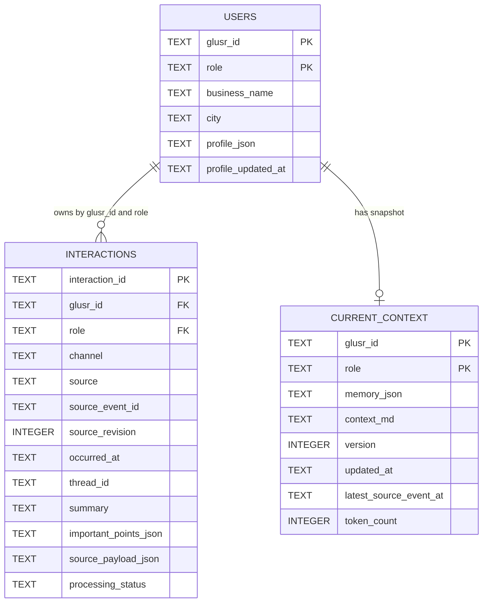

# VANI — Memory Across Channels

> **Sarvam AI Hackathon · Problem 2 — Global Context: Memory Across Channels**

VANI gives an IndiaMART voice agent durable, identity-isolated memory across voice, WhatsApp, web chat, app activity and enquiries. It loads compact seller context before a call, retrieves older evidence only when needed, and safely turns post-call extraction into memory for the next conversation.

The backend contains **no LLM**. Sarvam supplies the transcript, summary and proposed structured points; the Go services authenticate, validate, persist and render them deterministically.

## Submission contents

| Item | Location |
| --- | --- |
| Problem and design rationale | [approach.md](approach.md) |
| Evidence, expected impact and jury alignment | [impact.md](impact.md) |
| Setup, APIs and verification | This README |
| Actual build journey and lessons | [skills.md](skills.md) |
| Sarvam agent configuration | [agent/](agent/) |
| Sanitized outputs and evidence | [sample_outputs/](sample_outputs/) |
| Team details | [team.md](team.md) |
| Required 5–7 minute demo | Video link pending teammate upload |

> The final Sarvam `app_version` and demo video details are still required. The supplied agent URL is a login-required dashboard link, not a verified public demo link.

## What we built

- Shared three-table SQLite memory: `users`, `interactions` and `current_context`.
- Context API with one keyed snapshot read—no join, history scan or LLM on GET.
- Profile API returning the complete nested profile without summarizing it.
- Bounded Lookup API for older evidence and linked corrections/resolutions.
- Enrichment API that durably retains authenticated calls before extraction validation.
- Shared `memory_contract_v1` across prompt, validator, writer, Context and Lookup.
- Configurable 15-day recent-conversation window that preserves older open issues, restrictions, commitments and lasting preferences.
- User, role and thread isolation; idempotency; revisions; partial acceptance; and recoverable rebuilds.

## Why it matters

A cold-start assistant makes sellers repeat business details, preferences and unresolved problems. VANI turns authorised interactions into shared, source-linked memory for more relevant follow-up. These are expected benefits, not measured production improvements. See [impact.md](impact.md) for the supporting evidence and limitations.

## End-to-end architecture

```mermaid
flowchart LR
    A[Sarvam start hook] -->|GET /v1/context| B[Prepared seller context]
    B --> C[Voice conversation]
    C -. older detail needed .->|POST /v1/history/lookup| D[Bounded history + evidence]
    D -. result .-> C
    C --> E[Post-call extraction]
    E -->|POST /interactions/enrich| F[Durably retain raw call]
    F --> G{Validate identity, JSON, enums<br/>and exact caller evidence}
    G -->|trusted points| H[(interactions)]
    G -->|supported lasting preference| I[(users.profile_json)]
    G -->|warning or rejection| J[Validation provenance<br/>outside trusted memory]
    H --> K[Deterministic snapshot rebuild]
    I --> K
    K --> L[(current_context)]
    L -->|next start hook| B
```

The Profile API can load the complete profile before the conversation. History lookup is optional and only runs when detail is absent from the compact snapshot.

### Data model



The authoritative schema is [Context/migrations/001_initial.sql](Context/migrations/001_initial.sql).

## API responsibilities

All endpoints require `Authorization: Bearer <VANI_SERVICE_TOKEN>`.

| Service | Method and endpoint | Responsibility | Request-path behavior |
| --- | --- | --- | --- |
| Context | `GET /v1/context?glusr_id=...&role=seller` | Full profile, preferences and compact memory | One keyed `current_context` read |
| Profile | `GET /users/{glusr_id}/profile?role=seller` | Complete parsed nested profile | Keyed user read |
| Lookup | `POST /v1/history/lookup` | Older evidence and linked updates | Bounded parameterized identity/role search |
| Enrichment | `POST /interactions/enrich` | Retain call, validate, enrich and rebuild | Raw retention before nested validation |

Exact Sarvam mappings are in [agent/hook-mappings.md](agent/hook-mappings.md). `enrichment_json` is a **JSON-encoded String**; its `important_points_json` field is another **JSON-encoded String**, matching Sarvam String output variables.

## Quick start

Requirements: Go **1.26+**, ports `18080`–`18083`, and one environment-only service token of at least 16 characters. No system SQLite installation is needed.

```bash
cp .env.example .env
```

Before continuing, open `.env` and replace both placeholders:

```text
VANI_SERVICE_TOKEN=<your secret token, at least 16 characters>
VANI_DB_PATH=<absolute path to this extracted folder>/Context/data/vani.sqlite
```

All four services must load this same `.env` file so they use the same token and the same absolute SQLite path. Then initialize the database:

```bash
set -a
. ./.env
set +a

mkdir -p "$(dirname "$VANI_DB_PATH")"
(cd Context && go run ./cmd/vani migrate)
(cd Context && go run ./cmd/vani seed-synthetic)
(cd Context && go run ./cmd/vani rebuild)
```

The optional synthetic seed is explicit and idempotent. The server never seeds automatically. Do not continue while `.env` still contains either placeholder.

Start each API in a separate terminal. In every terminal, change to the extracted submission folder and load the same `.env` before running one service command:

```bash
cd /absolute/path/to/extracted/submission
set -a; . ./.env; set +a

(cd Context && go run ./cmd/vani serve)
(cd lookup && go run ./cmd/lookup)
(cd ProfileAPI && go run ./cmd/profile)
(cd EnrichmentAPI && go run ./cmd/enrichment)
```

Run only one of the four service commands per terminal.

Local endpoints bind to `127.0.0.1` by default. Temporary Quick Tunnel URLs used in the demo are excluded; stable deployment needs a persistent HTTPS reverse proxy.

Try Context:

```bash
curl -sS \
  -H "Authorization: Bearer $VANI_SERVICE_TOKEN" \
  'http://127.0.0.1:18080/v1/context?glusr_id=SYNTH-SELLER-001&role=seller'
```

Try Lookup:

```bash
curl -sS -X POST \
  -H "Authorization: Bearer $VANI_SERVICE_TOKEN" \
  -H 'Content-Type: application/json' \
  --data '{"glusr_id":"SYNTH-SELLER-001","role":"seller","topic_keyword":"catalog duplicate","lookback_days":"90"}' \
  'http://127.0.0.1:18081/v1/history/lookup'
```

See [sample_outputs/enrichment-request.json](sample_outputs/enrichment-request.json) for a complete post-call body.

## Before/after memory

| Before enrichment | After accepted resolution and rebuild |
| --- | --- |
| NACH auto-debit appears under **Open threads**. | A linked resolution records that it was resolved offline. |
| Snapshot version `11`. | Snapshot version `12`. |
| The next call treats NACH as unresolved. | The next call no longer lists NACH as open. |
| [Complete before sample](sample_outputs/context-before.md) | [Complete after sample](sample_outputs/context-after.md) |

This sanitized resolution came from a direct, clearly identified manual confirmation processed through the normal authenticated Enrichment API. It is **not** presented as a fresh Sarvam voice extraction. See its [linked Lookup evidence](sample_outputs/lookup-nach-resolution.json).

## Expected-output match

The implementation uses `(glusr_id, role)` consistently and exports builder-generated [buyer.md](sample_outputs/buyer.md) and [seller.md](sample_outputs/seller.md) for the clearly labelled `SYNTH-SELLER-001` fixture. The configured recent-history window is **15 days by default**, uses UTC, includes the exact cutoff, and is configurable from 1–365 days.

The synthetic seller fixture combines voice, WhatsApp and web-chat records in shared memory. It proves fixture-based cross-channel handling, not a live two-channel integration. See the [requirement-to-evidence table](impact.md#requirement-to-evidence).

## Validation and recovery

- The authenticated envelope and raw transcript/extraction are committed before nested extraction validation.
- Malformed extraction returns HTTP `202` with `extraction_status: rejected`; rejected content never enters trusted Context.
- Unsupported quotations produce indexed warnings while valid independent points continue.
- Evidence must exactly match a `USER`/`CALLER` transcript variant—never translated, paraphrased or fuzzy-matched.
- New issues get deterministic thread IDs; corrections and resolutions require an existing owned thread.
- Identical delivery is idempotent; changed content for the same source identity becomes a revision.
- Only explicit lasting language, callback-time, timezone and communication-style preferences can update profiles.
- Concurrent changes preserve unrelated nested fields; failed rebuilds remain retryable.

## Verification

Automated tests, recorded real calls and remaining unknowns are deliberately separated.

### Automated suite

```bash
./run-integration-audit.sh
```

| Module | Named tests | Result | Coverage highlights |
| --- | ---: | --- | --- |
| Context | 10 | PASS | nested profile, role isolation, 15-day boundary, old open requirements, rebuild |
| Enrichment | 12 | PASS | bilingual evidence, malformed retention, partial acceptance, replay/revision, conflicts, recovery |
| Lookup | 11 | PASS | bounded history, no-match, isolation, threads, corrections |
| Profile | 2 | PASS | complete nested profile and error handling |
| **Total** | **35** | **PASS** | Isolated temporary SQLite databases |

Captured output: [sample_outputs/test-results.txt](sample_outputs/test-results.txt).

### Real-call evidence

| Observation | Status | Qualification |
| --- | --- | --- |
| Context start hook reached API | VERIFIED | Recorded environment returned HTTP `200` |
| Sarvam on-end reached Enrichment | VERIFIED | Accepted and rejected requests appeared in logs |
| Accepted real calls stored and rebuilt Context | VERIFIED | Database and next Context inspected |
| Malformed extraction retained safely | VERIFIED | HTTP `202`; raw retained, trusted points excluded |
| Login-resolution repair | VERIFIED BY REVISION | Hindi evidence conflicted with English-only retained transcript; repaired normally |
| NACH offline resolution | VERIFIED MANUAL INPUT | Authenticated API confirmation, not a fresh voice extraction |
| Final agent always sends both transcript languages | NOT VERIFIED | Needs a call after final dashboard publication |
| Live conversation resumed across two different channels | NOT VERIFIED | Multi-channel continuity is fixture/test evidence only |

Full audit: [sample_outputs/real-call-verification.md](sample_outputs/real-call-verification.md).

### Supported measurements

Fixture measurements, sample sizes, estimation details and unmeasured metrics are documented in [impact.md](impact.md#success-metrics).

## 5–7 minute demo walkthrough

| Time | Show | What it proves |
| --- | --- | --- |
| 0:00–0:40 | Problem and architecture | Cross-channel memory scope |
| 0:40–1:30 | Profile and Context hook | Complete profile plus prepared memory |
| 1:30–2:30 | Voice conversation | Agent starts with known context |
| 2:30–3:20 | Optional history lookup | Older evidence without prompt bloat |
| 3:20–4:30 | Enrichment response | Durable retention and visible validation |
| 4:30–5:30 | Database and rebuilt Context | Accepted facts affect the next call |
| 5:30–6:30 | Before/after and resolution | Corrections stop outdated repetition |
| 6:30–7:00 | Tests and limitations | Evidence-bounded claims |

The recorded demo link is pending teammate upload and must remain between **5 and 7 minutes**.

## Limitations

| Limitation | Current behavior / mitigation |
| --- | --- |
| Caller-only trusted evidence | Assistant commitments require a future authorised speaker-aware extension. |
| No call-session binding table | Service auth plus existing `(glusr_id, role)` validation in the three-table MVP. |
| Single-host SQLite worker | Hackathon scope, not horizontal production deployment. |
| Estimated token budget | Deterministic estimate, not a model-specific tokenizer. |
| Temporary demo hosting | Quick Tunnels depend on the laptop and are not stable URLs. |
| Sarvam transcript variability | Raw calls retained; invalid facts stay untrusted and are revision-recoverable. |
| Final dual-language delivery | Needs one fresh real call after final agent publication. |

## Package map

| Path | Contents |
| --- | --- |
| `Context/` | Migration, fixtures, contract, snapshot builder, worker, API and tests |
| `ProfileAPI/` | Complete profile-read API and tests |
| `lookup/` | Bounded historical lookup API and tests |
| `EnrichmentAPI/` | Ingestion, validation, enrichment, revisions and tests |
| `agent/` | Greeting, instructions, exact prompt, mappings and metadata |
| `sample_outputs/` | Sanitized bodies, before/after memory and verification evidence |
| `.env.example` | Placeholder-only configuration |
| `run-integration-audit.sh` | Repeatable four-module test runner |

## Security and hygiene

The package excludes populated `.env` files, bearer tokens, API keys, live SQLite/WAL files, logs, tunnel output, dependency/vendor directories and editor artifacts. Request bodies, authentication headers and response bodies are not logged. Use `.env.example` only as a template.
