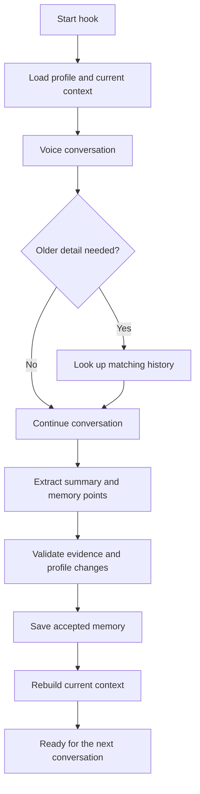

# VANI — Memory Across Channels

> **Sarvam AI Hackathon · Problem 2: Global Context — Memory Across Channels**

VANI gives an IndiaMART voice agent a shared, trusted memory of each seller or buyer. It loads a short briefing before the call, looks up older details only when needed, and saves supported information for the next conversation.

The backend contains no LLM. Sarvam supplies the transcript and proposed structured points; the Go services validate, store and render them deterministically.

## Start here

| Read | Purpose |
| --- | --- |
| [Approach](approach.md) | The problem, design and key choices |
| [Impact and evidence](impact.md) | Requirements, measurements, jury criteria and limitations |
| [Build journey](skills.md) | Tools, integration failures, fixes and lessons |
| [Sample outputs](sample_outputs/README.md) | Sanitized Context, Lookup and Enrichment examples |
| [Agent configuration](agent/README.md) | Greeting, instructions, extraction prompt and hook mappings |
| [Agent details](agent/agent-details.md) | Verified Agent ID and dashboard-link status |
| [Team](team.md) | Kaizen team members |

The recorded 5–7 minute demo link is pending teammate upload.

## The problem

Without shared memory, every conversation starts cold. A seller may need to repeat their business details, preferred calling time and unresolved issues. A correction made in one interaction may not reach the next, and unrelated problems may be mixed together.

VANI connects the implemented features to practical benefits:

| Feature | Practical benefit |
| --- | --- |
| Profile and Context loaded before speaking | A more relevant opening and fewer repeated questions |
| Compact Context plus optional history Lookup | Older details remain available without loading all history into every call |
| Separate issue threads | Login, NACH, catalogue and other problems remain independent |
| Post-call Enrichment | Supported new information becomes available in later conversations |
| Explicit preferences | Language and calling-time preferences can personalize future calls |
| Shared HTTP APIs | Other authorised clients can reuse the same memory layer |

These are expected benefits, not measured production improvements. See [impact.md](impact.md) for evidence and boundaries.

## How VANI works



### Demo setup

Retained live Sarvam requests show the demo agent using the fixed trusted identity `SYNTH-SELLER-PRANJAL-001` with role `seller`. This is the synthetic **Pranjal Ltd** seller; no city is stored. Its short current context records that the login and NACH auto-debit issues were resolved and retains recent voice and WhatsApp history. The backend keeps every seller or buyer separate using the `(glusr_id, role)` key.

### Using VANI for another seller

Before calling another seller:

1. Ensure their profile and prepared Context exist in the database.
2. Set the Sarvam input variables to that seller's `glusr_id` and `role = seller`.
3. Map those same identity values into Context, Profile, Lookup and Enrichment requests.

VANI will then load and update that seller's memory. The current demo uses one configured test seller; automatic identity selection for outbound campaigns is not implemented.

The shared SQLite database has three tables:

- `users` — identity, business metadata and complete profile JSON;
- `interactions` — channel history, sources, evidence and processing state; and
- `current_context` — the versioned briefing used at conversation start.

The recent-conversation window is **15 UTC days by default**. Older unresolved threads, restrictions, commitments and lasting preferences remain in Context; full older history remains available through Lookup.

## Before and after

This sanitized example uses a clearly labelled synthetic seller:

| Before | After an accepted resolution |
| --- | --- |
| NACH auto-debit appears under **Open threads**. | A linked resolution records that it was resolved offline. |
| Context version `11`. | Rebuilt Context version `12`. |
| The next conversation treats NACH as unresolved. | NACH is no longer listed as open. |
| [View the before Context](sample_outputs/context-before.md) | [View the after Context](sample_outputs/context-after.md) |

The resolution was a direct authenticated manual confirmation, not a fresh Sarvam voice extraction. [View the linked Lookup evidence](sample_outputs/lookup-nach-resolution.json).

## API responsibilities

Every endpoint requires `Authorization: Bearer <VANI_SERVICE_TOKEN>`.

| Service | Method and endpoint | Responsibility |
| --- | --- | --- |
| Context | `GET /v1/context?glusr_id=...&role=seller` | Return the complete profile, preferences and compact prepared memory |
| Profile | `GET /users/{glusr_id}/profile?role=seller` | Return the complete parsed nested profile |
| Lookup | `POST /v1/history/lookup` | Retrieve bounded historical evidence and linked corrections |
| Enrichment | `POST /interactions/enrich` | Retain the call, validate extraction, apply supported updates and rebuild Context |

`enrichment_json` is a JSON-encoded String. Its `important_points_json` field is also a JSON-encoded String, matching Sarvam String output variables. See the exact [hook mappings](agent/hook-mappings.md) and [extraction prompt](agent/extraction-prompt.txt).

## Run locally

### Requirements

- Go 1.26 or newer
- Local ports `18080`–`18083`
- One service token with at least 16 characters

No system SQLite installation is required.

### 1. Configure one shared environment

```bash
cp .env.example .env
```

Edit `.env` and replace both placeholders:

```text
VANI_SERVICE_TOKEN=<your secret token, at least 16 characters>
VANI_DB_PATH=<absolute path to this repository>/Context/data/vani.sqlite
```

All four services must load this same file so they use the same token and absolute database path.

### 2. Initialize the database

```bash
set -a
. ./.env
set +a

mkdir -p "$(dirname "$VANI_DB_PATH")"
(cd Context && go run ./cmd/vani migrate)
(cd Context && go run ./cmd/vani seed-synthetic)
(cd Context && go run ./cmd/vani rebuild)
```

The optional synthetic seed is explicit and idempotent. The server never seeds automatically.

### 3. Start the services

Use a separate terminal for each service. In every terminal, change to the repository root and load the same `.env`:

```bash
set -a
. ./.env
set +a
```

Then run one command per terminal:

```bash
(cd Context && go run ./cmd/vani serve)          # 127.0.0.1:18080
(cd lookup && go run ./cmd/lookup)               # 127.0.0.1:18081
(cd ProfileAPI && go run ./cmd/profile)          # 127.0.0.1:18082
(cd EnrichmentAPI && go run ./cmd/enrichment)    # 127.0.0.1:18083
```

### 4. Try the APIs

Context:

```bash
curl -sS \
  -H "Authorization: Bearer $VANI_SERVICE_TOKEN" \
  'http://127.0.0.1:18080/v1/context?glusr_id=SYNTH-SELLER-001&role=seller'
```

History Lookup:

```bash
curl -sS -X POST \
  -H "Authorization: Bearer $VANI_SERVICE_TOKEN" \
  -H 'Content-Type: application/json' \
  --data '{"glusr_id":"SYNTH-SELLER-001","role":"seller","topic_keyword":"catalog duplicate","lookback_days":"90"}' \
  'http://127.0.0.1:18081/v1/history/lookup'
```

See [enrichment-request.json](sample_outputs/enrichment-request.json) for a complete post-call request.

## Verification

Run the repeatable audit:

```bash
./run-integration-audit.sh
```

| Module | Named tests | Result | Main coverage |
| --- | ---: | --- | --- |
| Context | 10 | PASS | nested profile, role isolation, 15-day boundary and rebuild |
| Enrichment | 12 | PASS | evidence, partial acceptance, retries, revisions and recovery |
| Lookup | 11 | PASS | bounded search, no-match, isolation, threads and corrections |
| Profile | 2 | PASS | complete nested profile and error handling |
| **Total** | **35** | **PASS** | Isolated temporary SQLite databases |

[View captured test results](sample_outputs/test-results.txt).

### Evidence labels

| Evidence type | What is established |
| --- | --- |
| Automated tests | Identity isolation, evidence validation, partial acceptance, idempotency, revisions and rebuild recovery |
| Real Sarvam calls | Context start and Enrichment end requests reached the APIs; accepted and rejected deliveries were inspected |
| Synthetic fixtures | Voice, WhatsApp and web-chat records can be combined without mixing roles or issue threads |

Fixture-based cross-channel support is not presented as a live WhatsApp-to-voice demonstration. See [real-call verification](sample_outputs/real-call-verification.md).

## Limitations

| Limitation | Current boundary |
| --- | --- |
| Caller-only trusted evidence | Assistant commitments require a future authorised speaker-aware extension |
| Live cross-channel proof | WhatsApp/web-chat to voice continuity is demonstrated with fixtures, not a deployed non-voice writer |
| Hindi/Hinglish verification | Backend bilingual tests pass, but final dual-language dashboard delivery and live voice quality remain unverified |
| Hosting | Demo Quick Tunnels depend on local processes and are not stable deployment URLs |
| Scale | SQLite and in-process workers are suitable for this hackathon MVP, not horizontal production deployment |
| Token count | Context uses a deterministic estimate, not a model-specific tokenizer |

## Security and repository hygiene

The repository excludes populated `.env` files, bearer tokens, API keys, databases/WAL files, logs, recordings, tunnel output, generated binaries and dependency directories. Lookup logs method, path, status and duration—not request bodies, authentication headers or response contents.
