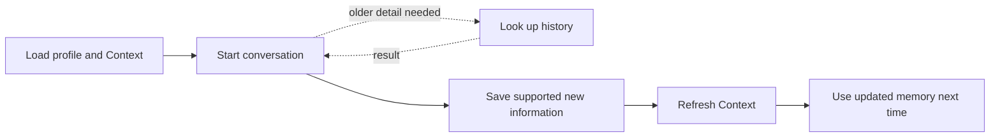

# Our approach

[← Back to README](README.md) · [Impact and evidence](impact.md)

## The problem

A seller may speak to IndiaMART more than once and through different channels. Without shared memory, every conversation starts from zero:

- the seller must repeat information;
- earlier preferences may be forgotten;
- unresolved issues may be missed; and
- separate problems may get mixed together.

VANI addresses **Problem 2 — Global Context: Memory Across Channels** by giving the assistant one shared, structured memory for each GLUSR ID and role.

## The solution

VANI uses four small APIs connected to one shared database:

| API | What it does |
| --- | --- |
| Context | Loads a short seller or buyer briefing before the conversation |
| Profile | Returns the complete business profile |
| Lookup | Finds an older detail when it is not in the short briefing |
| Enrichment | Saves supported information after the conversation and refreshes Context |

## How memory works

Every request is identified by both `glusr_id` and `role`, so buyer and seller memory remains separate.

The prepared Context contains:

- business name and city;
- current preferences;
- restrictions and commitments;
- unresolved issue threads; and
- conversation summaries from the last **15 days**.

Important unresolved information is retained even when it is older than 15 days. Full older history remains available through Lookup.

Each issue has its own thread. For example, resolving a login problem does not close an unrelated NACH or catalogue problem.

## Why we chose short Context plus Lookup

Sending all history into every conversation would make the prompt long and harder to use. VANI instead provides:

1. a compact prepared Context for information needed regularly; and
2. a focused history Lookup for older details needed occasionally.

This gives the agent useful memory without placing all stored history into every prompt.

## Keeping memory trustworthy

Sarvam provides the transcript and proposed conversation points. The backend validates them before adding them to trusted memory.

- Evidence must match the caller's transcript.
- Unsupported points are excluded.
- Valid independent points can still be saved.
- Repeated delivery does not create duplicate interactions.
- Corrected deliveries are stored as revisions.

The original conversation is retained when extraction is malformed, but rejected information is kept outside trusted Context.

## Expected value

VANI is designed to provide:

- more relevant conversation openings;
- fewer repeated questions;
- continuity for unresolved issues;
- language and calling-time personalization; and
- shared memory that other authorised channels can reuse.

These are expected benefits. We did not measure production conversion, savings or call-time improvements during the hackathon.

Verification status, measurements and material limitations are kept in the supporting [impact and evidence document](impact.md).
