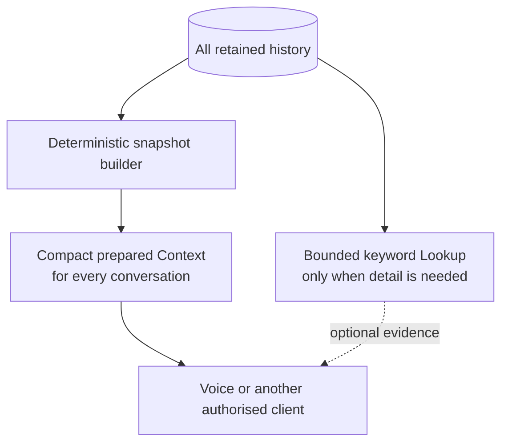

# Impact and Evidence

[← README](README.md) · [Approach](approach.md) · [Build journey](skills.md)

## Problem and expected business value

VANI uses one evidence-backed memory for each GLUSR ID and role. The benefits below are **expected impact**. We did not run a production experiment and make no claim about conversion, savings, call duration or percentage improvement.

| Capability demonstrated | Expected impact | Important boundary |
| --- | --- | --- |
| Load full profile and prepared Context before speech | More relevant opening; fewer repeated questions | Start-hook HTTP success is real-call evidence; opening quality was not independently scored |
| Retrieve older history by keyword | Recall exceptional detail without loading every old interaction into every prompt | Lookup is bounded and structured, not semantic LLM search |
| Keep issue threads separate | Avoid applying a correction or resolution to an unrelated enquiry | Requires an owned thread ID for corrections/resolutions |
| Enrich after a conversation | Make supported new facts and preferences available on a later call | Unsupported evidence stays out of trusted memory |
| Persist explicit lasting preferences | Personalize language and calling time without turning temporary conditions into profile facts | Allowlist only; evidence-backed updates |
| Expose shared HTTP/JSON APIs | Let future authorised channels reuse the same memory | Live non-voice client integration was not demonstrated |

## Requirement-to-evidence

| Expected output | Implemented behavior | Concrete evidence | Status / limitation |
| --- | --- | --- | --- |
| GLID/GLUSR ID + role identity | All reads/writes are scoped to `(glusr_id, role)`; roles are `buyer` or `seller` | [Migration](Context/migrations/001_initial.sql), Context/Profile/Lookup/Enrichment tests | Verified by automated tests |
| Generated `buyer.md` and `seller.md` | Deterministic builder exports separate snapshots for one shared synthetic GLID | [buyer.md](sample_outputs/buyer.md), [seller.md](sample_outputs/seller.md), sample-export equality test | Verified with synthetic fixtures |
| Context loaded before speaking | Start mapping calls Context before conversation | [Hook mapping](agent/hook-mappings.md); real logs observed HTTP `200` as recorded in [real-call verification](sample_outputs/real-call-verification.md) | API delivery verified; opening quality not scored |
| Conversation resumed across two channels | Shared thread contains web-chat/WhatsApp history and a later voice summary | [seller.md](sample_outputs/seller.md) and synthetic seed in `Context/internal/storage/seed.go` | Fixture/test only; no live two-channel handoff recording |
| Short, structured memory | Headings for profile, preferences, restrictions, open threads, commitments and recent conversations | [seller.md](sample_outputs/seller.md), builder code, compactness measurements below | Verified by automated tests |
| Refresh after new activity | Accepted Enrichment persists, rebuilds, marks processed and returns `context_version`; stale/retry workers recover failures | Enrichment service and recovery tests; [accepted response](sample_outputs/enrichment-accepted.json) | Verified by automated tests; real latency distribution unmeasured |
| Sources | Durable points and Markdown include source IDs, timestamps and channels; Lookup returns evidence | [Lookup sample](sample_outputs/lookup-nach-resolution.json) | Verified by tests and inspected synthetic records |
| Lookback window | Recent summaries use UTC and an inclusive cutoff; older unresolved durable state remains | Default **15 days**, configurable 1–365 via `VANI_RECENT_HISTORY_DAYS`; exact-boundary test | Verified by automated tests |
| Refresh logic | Profile or interaction revision makes a snapshot stale; publication rechecks revisions before commit | Context builder/store tests and recovery tests | Verified by automated tests |

### What the two-channel fixture proves

`SYNTH-SELLER-001/seller` contains a shared catalogue thread with a WhatsApp screenshot, a web-chat boundary record and a later voice interaction. The generated voice-ready Context retains the open issue and sources. This demonstrates that the database, builder and API can combine allowed channels without mixing roles or threads.

It is seeded synthetic history. It is **not proof** that a production WhatsApp webhook wrote the record or that the recorded voice agent resumed a live WhatsApp conversation. A real two-channel demo remains an expected-output gap.

## Why prepared Context plus Lookup

Putting all history into every prompt would grow continuously and bury current priorities. VANI instead prepares a bounded briefing for the common path and exposes a deterministic evidence lookup for exceptional detail. This keeps full `profile_json` outside the Markdown budget and preserves older history in SQLite even when it is absent from recent Context.

## Success metrics

### Evidence available now

| Metric | Observed evidence | Sample and source | Interpretation |
| --- | --- | --- | --- |
| Freshness | Accepted Enrichment performs a synchronous rebuild before returning `200` with `context_version`; failure returns `202` and retry state. The fallback workers default to 2-second scans. | Code plus automated acceptance/recovery tests; no controlled production timing sample | Functional freshness is verified; wall-clock real-call latency is **not measured** |
| Compactness | Buyer: **328 bytes / 82 estimated tokens**. Seller 001: **1,135 bytes / 283 estimated tokens**. Seller 002: **339 bytes / 84 estimated tokens**. | 3 synthetic exported snapshots; files in `Context/samples/` and `sample_outputs/` | All are below the default 900 estimated-token budget; not a traffic distribution |
| Estimation method | `(Unicode rune count + 3) / 4`, integer division; stored as `token_count_method: estimated` | `Context/internal/memory/builder.go` | Model-independent approximation, not a tokenizer measurement |
| Continuity | Seller Context recalls callback-after 17:00, an older restriction, an older commitment, an open catalogue thread and recent voice/WhatsApp/web-chat summaries without another user answer | 1 synthetic seller fixture; [seller.md](sample_outputs/seller.md) | Demonstrates memory behavior, not a live two-channel outcome |
| Personalized opening | Real start hook returned `200` and supplied business/context fields | Recorded integration environment; [real-call verification](sample_outputs/real-call-verification.md) | Delivery verified; whether the agent always used it naturally is unmeasured |
| Reusability | Four authenticated JSON APIs share one schema; channel enum supports voice, WhatsApp, web chat, app, enquiry and other | Code and isolation tests | Interface reuse verified; live clients beyond Sarvam voice not demonstrated |

### How to evaluate what remains unmeasured

| Metric | Evaluation method |
| --- | --- |
| Receipt-to-ready freshness | Compare `received_at`, snapshot `updated_at` and hook-readable versions across accepted real calls; report normal and retry cases separately |
| Repetition reduction | Label a test set of follow-up calls; count facts correctly recalled before the caller repeats them versus a cold-start control |
| Personalized opening | Review a balanced Hindi/English call sample for correct business, city, active thread and preference use; score incorrect or awkward references separately |
| Live cross-channel continuity | Create an issue through a real WhatsApp/web-chat writer, then start a voice call for the same GLUSR/role and verify the exact sourced thread is used |
| Voice latency and quality | Measure audio turn latency and human-rate Hindi/Hinglish naturalness on the final published Sarvam version; backend HTTP tests are insufficient |

## Before and after

| Before | Accepted resolution and rebuilt Context |
| --- | --- |
| NACH appears as an open thread in snapshot version 11 | The linked resolution is retained and the open-thread section disappears in version 12 |
| [View before](sample_outputs/context-before.md) | [View after](sample_outputs/context-after.md) |

This is a sanitized synthetic seller example. The resolution was a direct authenticated manual confirmation, not a fresh Sarvam voice extraction.

## Jury criteria alignment

| Criterion | Evidence | Material limitation |
| --- | --- | --- |
| **Business Impact — 25%** | Addresses repeated questions, continuity, source-linked corrections and safe preferences; see expected-impact table above | Benefits are expected, not measured in production |
| **Solution Completeness — 20%** | Four runnable APIs, shared migration, seed, complete profile, prepared Context, Lookup and post-call Enrichment; [setup](README.md#run-locally) | Stable deployment and live two-channel writer are outside the package |
| **Technical Robustness — 20%** | 35 tests cover identity isolation, exact evidence, partial acceptance, raw-call retention, idempotency, revisions, concurrency and rebuild recovery; [test output](sample_outputs/test-results.txt) | SQLite/in-process workers are single-host MVP choices |
| **Voice Experience — 20%** | Sarvam start/on-end hooks reached APIs; Hindi evidence mismatch was diagnosed; bilingual transcript variants are supported and backend-tested | Backend bilingual tests do not prove live Hindi/Hinglish quality or audio latency; final dual-language delivery remains unverified |
| **Demo & `skills.md` — 15%** | Sanitized before/after, Lookup, accepted/rejected Enrichment and factual [build journey](skills.md) | Final video URL, duration and Sarvam `app_version` are still required |

## Trust boundaries demonstrated

- Exact caller-evidence validation; no fuzzy or translated quote matching.
- Partial acceptance of valid independent points while invalid points remain untrusted.
- Durable raw transcript/extraction retention for validly authenticated identities before nested validation.
- Idempotent duplicate delivery and explicit same-source revisions.
- GLUSR, role and thread isolation.
- Recoverable failed Context generation with processing states and retry.

These behaviors are implemented and tested. Assistant-spoken commitments, durable multi-host operation, live WhatsApp ingestion and production-scale performance remain future work.
